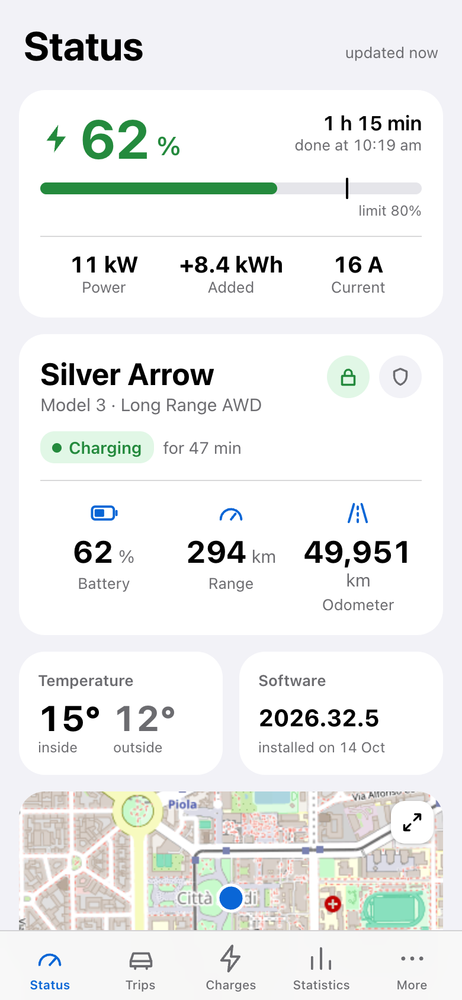
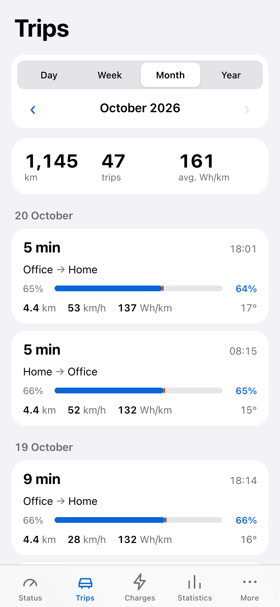
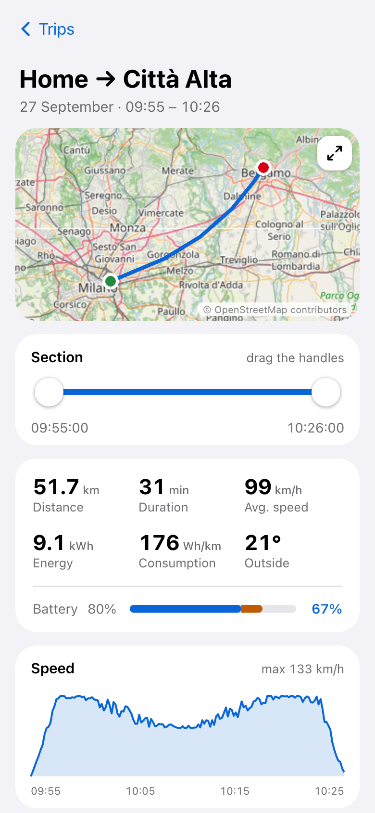
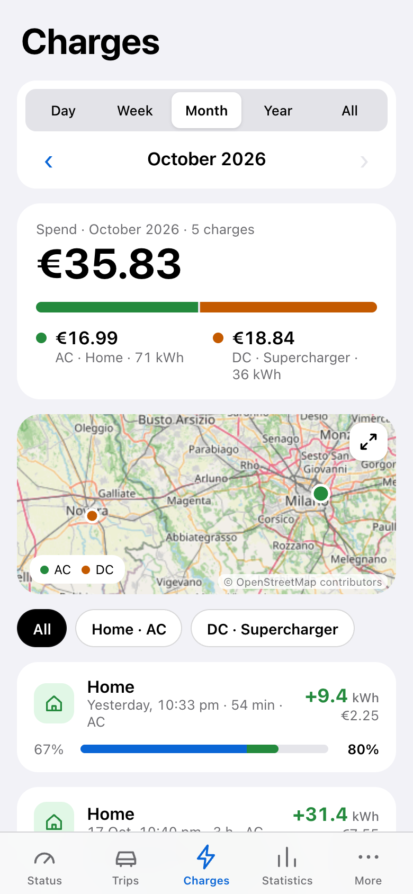
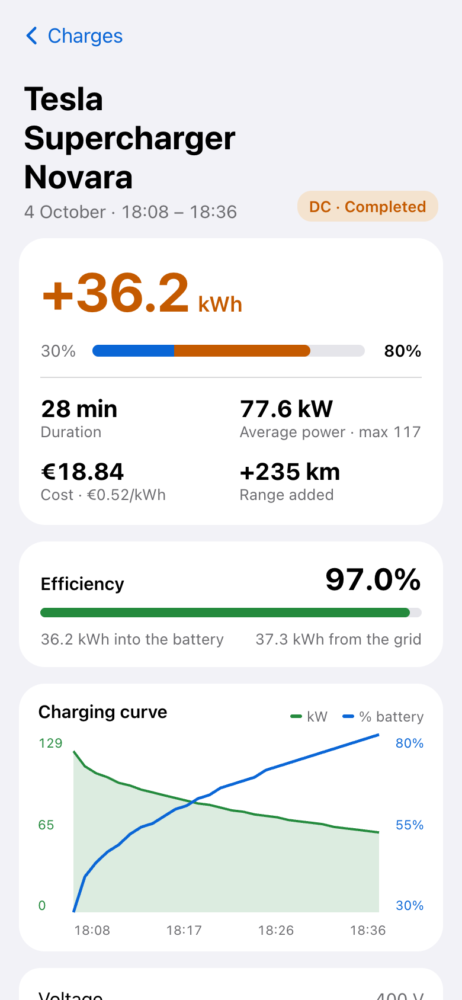
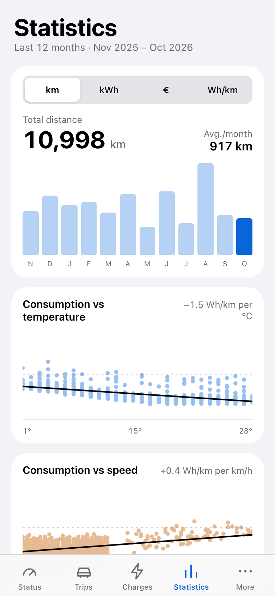
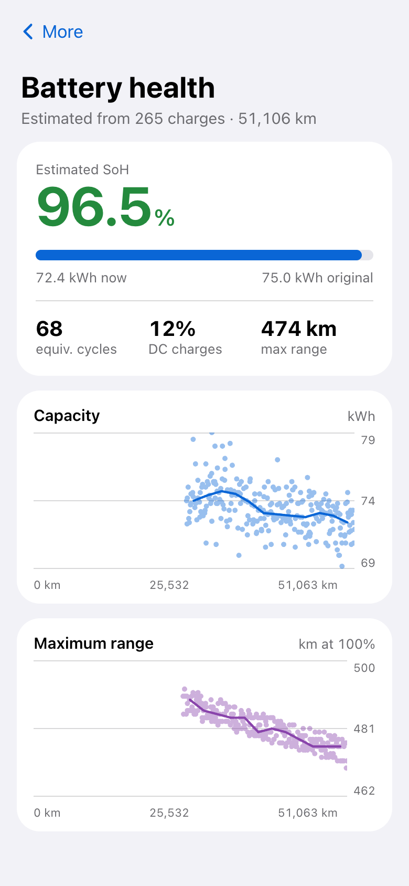
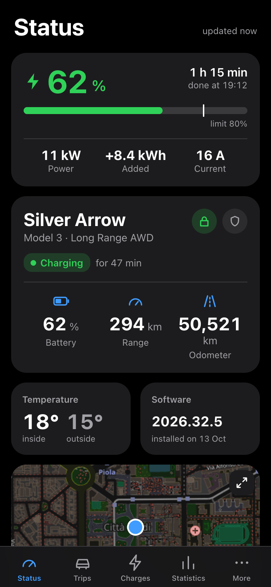

# TeslaMate PWA

A read-only mobile web app for your [TeslaMate](https://github.com/teslamate-org/teslamate) data:
car status, drives, charges, statistics and battery health, installable on the phone home screen.
It reads everything from [TeslaMateAPI](https://github.com/tobiasehlert/teslamateapi) and never sends
commands to the car.

> Not affiliated with Tesla, Inc. or with the TeslaMate project.

<p>
  
  
  
  
</p>
<p>
  
  
  
  
</p>

<sub>Screenshots taken with invented demo data.</sub>

**Screens:** phone, tablet and desktop layouts (side bar and list + detail for trips and charges from 1100 px). Trips and charges of the selected period can be exported as CSV. Idle (parked) battery drain is worked out from stops of 12 h or more.
**Languages:** English and Italian: follows the device, can be chosen per device in the app or set in `config.js`.
**Units:** km or miles and °C or °F, following TeslaMate's settings (elevation always in metres); currency set in `config.js`.

## Requirements

- A running TeslaMate with **TeslaMateAPI**.
- The PWA must be served from the **same host** as TeslaMateAPI (`/pwa/` next to `/api/v1/`):
  no CORS and no token needed.
- **HTTPS**: browsers install a PWA and run its service worker only over HTTPS.

## ⚠️ Security

The app has **no login**. Anyone who can reach `/pwa/` and `/api/v1/` sees your car's location and
history. Keep both behind a VPN or an authenticating reverse proxy.
`config.js` is a public file: never put secrets in it (see `token` below).

Note: on iOS, HTTP Basic Auth works poorly with installed PWAs; a VPN is the smoothest option.

## Deploy with Docker

This PWA is an add-on to an existing TeslaMate installation: it needs TeslaMateAPI on the **same HTTPS host**.
It does not run TeslaMate, PostgreSQL or TeslaMateAPI itself.

### 1. Check TeslaMateAPI

From the host (or in a browser), confirm that TeslaMateAPI is reachable before deploying the PWA:

```bash
curl -fsS https://teslamate.example.com/api/v1/cars
```

It must return JSON. Do not expose this endpoint publicly unless it is protected: the PWA is read-only but shows
location and history.

### 2. Add the PWA service

Create a `pwa-config.js` next to your existing `compose.yaml` and copy the repository's
[`config.js`](config.js) into it. Normally the defaults are enough: keep `apiBase: "/api/v1"` and leave
`token` empty. It is a public browser file: **never put a secret in it**.

Add this service to the same Compose project that owns your reverse proxy. Replace the Traefik labels with
the equivalent configuration for nginx, Caddy or another proxy if necessary.

```yaml
services:
  pwa:
    # Pin a published version for predictable upgrades; see GitHub Releases for the current version.
    image: ghcr.io/svincio/teslamate-pwa:0.11.1
    restart: unless-stopped
    volumes:
      - ./pwa-config.js:/usr/share/nginx/html/pwa/config.js:ro
    labels:
      - "traefik.enable=true"
      - "traefik.http.routers.teslamate-pwa.rule=Host(`teslamate.example.com`) && (Path(`/pwa`) || PathPrefix(`/pwa/`))"
      - "traefik.http.routers.teslamate-pwa.entrypoints=websecure"
      - "traefik.http.routers.teslamate-pwa.tls=true"
      - "traefik.http.services.teslamate-pwa.loadbalancer.server.port=80"
```

For another reverse proxy, forward **`/pwa/` without stripping the prefix** to port 80 of the container.
The PWA and TeslaMateAPI must remain on one origin, for example:

```text
https://teslamate.example.com/pwa/       → PWA container
https://teslamate.example.com/api/v1/... → TeslaMateAPI
```

### 3. Start and install

```bash
docker compose pull pwa
docker compose up -d pwa
docker compose logs --tail=30 pwa
```

Open `https://teslamate.example.com/pwa/` and add it to the phone home screen
(Safari: Share → **Add to Home Screen**). The container serves only `/pwa/`; the proxy must provide HTTPS.

### Update and rollback

Published versions are listed in [GitHub Releases](https://github.com/svincio/teslamate-pwa/releases) and
have matching GHCR tags (`0.11.1`, `0.11.0`, …). Change the image tag in Compose, then run the two commands
above. To roll back, pin the previous release tag and run them again. `:latest` follows `main` and is suitable
only if you explicitly want automatic feature updates.

Image: `ghcr.io/svincio/teslamate-pwa` (linux/amd64 and linux/arm64).

Without Docker, serve the files under `/pwa/` with any web server (see `nginx.conf`). A production deployment
must run `npm ci && npm run build` and serve `dist/`, rather than compiling JSX in the browser.
## Configuration

Copy [`config.js`](config.js), edit it and mount it as shown above:

| Key | Default | Meaning |
|---|---|---|
| `apiBase` | `"/api/v1"` | TeslaMateAPI base URL. Keep it same-origin. |
| `carId` | `1` | TeslaMate car id. With more cars, each device can pick another one in More → This device |
| `token` | `""` | TeslaMateAPI `API_TOKEN`. Not needed for read-only endpoints; it would be readable by anyone. |
| `refreshSeconds` | `60` | Status polling interval while the app is open, `0` disables it |
| `textSize` | `"auto"` | `"auto"` (iPhone/iPad text size setting) or a percentage from 80 to 300, capped on narrow screens. Per-device override in More → This device |
| `clock` | `"auto"` | `"auto"` (device habit), `"24"` or `"12"` (AM/PM). Per-device override in More → This device |
| `theme` | `"auto"` | `"auto"` (system setting), `"light"` or `"dark"`. Per-device override in More → This device |
| `numbers` | `"auto"` | Separators: `"auto"` (device format), `"comma"` 1.234,5, `"dot"` 1,234.5, `"space"` 1 234,5. Per-device override in More → This device |
| `lang` | `"auto"` | `"auto"` (device language, English if not Italian), `"it"` or `"en"`. Each device can override it in More → This device |
| `priceAcPerKwh`, `priceDcPerKwh` | `null` | Price per kWh estimate when TeslaMate records no charge cost |
| `currency` | `"EUR"` | ISO 4217 code of your costs (`USD`, `GBP`, `CHF`…) |

Better: set the cost per kWh in TeslaMate's geofences, it is then used by Grafana too.

## How it works

- `pwa.html` loads React and Leaflet from unpkg (with SRI). In the Docker image the `.jsx` files are
  compiled at build time (`build.js` → `dist/`), which makes the start about four times faster; when you
  serve the source tree directly (development), Babel standalone compiles them in the browser.
- `api.jsx` calls TeslaMateAPI, normalizes the data and caches the last state in `localStorage`,
  so the app opens instantly with the last known data.
- `sw.js` caches the app shell; API calls always go to the network.
- Maps use standard OpenStreetMap tiles.

Third parties contacted by the browser: unpkg.com (libraries) and tile.openstreetmap.org (maps).

## Releases (maintainers)

A GitHub Release is created only from a signed version tag pushed by a maintainer. The same tag publishes
matching multi-architecture GHCR images (for example `0.12.0`) and generated release notes.

After merging a release branch to `main`, update `APP_VERSION` and the service-worker cache, then:

```bash
git switch main
git pull --ff-only
git tag -s v0.12.0 -m "TeslaMate PWA 0.12.0"
git push origin v0.12.0
```

The `docker` workflow builds the image first and then creates the GitHub Release. It does not run for ordinary
pushes to `main`; those update only the `latest` and SHA image tags.

## Development

```bash
TM_API_HOST=teslamate.example.com node local-server.js   # http://localhost:8000/pwa.html
```

`local-server.js` serves the files and proxies `/api/v1` to your TeslaMateAPI over HTTPS.
Without a TeslaMate at hand, `TM_MOCK=1 node local-server.js` serves invented data instead
(Milan area, about two years of trips and charges, see `demo/mock-api.js`); add `TM_MOCK_UNITS=imperial`
for miles and °F, `TM_MOCK_CARS=2` for a second car.

End-to-end tests run a real Chrome (Google Chrome or Chromium installed) against your data or the demo data:

```bash
npm install
TM_API_HOST=teslamate.example.com npm test   # your TeslaMate
TM_MOCK=1 npm test                           # demo data
node demo/screenshots.js                     # regenerates docs/screenshots/
```

`npm run build` writes the compiled app to `dist/`; `ROOT=dist TM_MOCK=1 npm test` runs the same tests on it.
GitHub Actions runs both on every pull request (`.github/workflows/test.yml`).

When you add or rename app files, update the list in `sw.js` (and bump `CACHE`) and in the `Dockerfile`
(the script list itself is read from `pwa.html`).

## License

[MIT](LICENSE)
